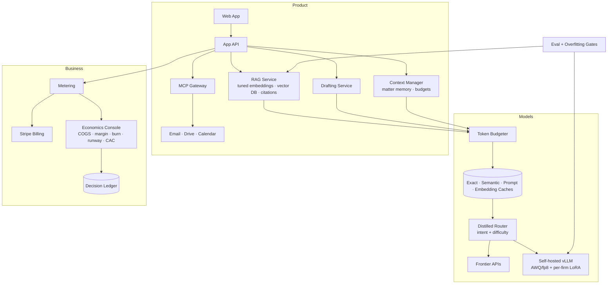

# AI Startup-in-a-Box: System Architecture

> The ultimate capstone that uses all 15 concepts: build, launch and run a real AI SaaS product end to end, from model stack to unit economics, and make it profitable.
>
> **Concepts:** `RAG`, `MCP`, `Vector Database`, `Tokenization`, `Context Window`, `Fine Tuning`, `Overfitting`, `Embeddings`, `Knowledge Distillation`, `LoRA`, `Burn Rate`, `CAC`, `LLMs`, `Caches`, `Quantization`

## 1. High-Level View

Three planes. The product plane (web app, RAG, drafting, integrations). The model plane (inference router across provider APIs and self-hosted quantised models with LoRA adapters, distilled router, caches, context manager). The business plane (metering, billing, economics console, decision ledger).

## 2. Components

| Component | Responsibility |
|---|---|
| RAG service | Hybrid retrieval, fine-tuned embedder, re-ranker, verification. |
| Drafting service | Base SFT model + per-firm LoRA. |
| MCP gateway | Integrations with policy and audit. |
| Context manager | Matter memory + budgeted packing. |
| Router | Distilled classifier → model tier. |
| Inference | Provider APIs + vLLM (quantised, multi-LoRA). |
| Caches | Four layers with tenant scoping. |
| Metering/billing | Events → Stripe. |
| Economics console | COGS/margin/burn/runway/CAC. |
| Decision ledger | Change → measured impact records. |

## 3. Request / Data Flow

1. Lawyer asks a question about a matter.
2. Context manager loads matter memory; RAG retrieves cited passages.
3. Token budgeter trims to the feature's budget; cache checked.
4. Router picks a model (cheap quantised for simple, frontier for complex).
5. Answer verified and returned; usage metered with cost.
6. Nightly: economics recomputed; ledger updated for any change shipped that day.

## 4. Data Stores

| Store | Holds | Why |
|---|---|---|
| Postgres (RLS) + pgvector | Tenants, docs, chunks, memory | Simplicity at startup scale. |
| S3 | Documents, adapters | Blobs. |
| Redis | Caches | Speed. |
| ClickHouse/DuckDB | Metering + analytics | Economics. |

## 5. Deployment Topology

- Start: Fly/Render + provider APIs.
- Later: one GPU node (L40S) for vLLM high-volume paths.
- EU/US regions as customers require.

## 6. Scaling Strategy

- Scale by moving high-volume paths to self-hosted quantised models only when the ledger shows margin gain.

## 7. Security & Privacy

- Per-firm isolation (RLS, scoped caches/adapters).
- Encryption, SSO, audit; no training on customer data without opt-in.

## 8. Observability

- Product: faithfulness, latency. Models: cost/request, cache hits, router accuracy. Business: MRR, margin, burn, CAC, payback.

## 9. Failure Modes

| Failure | Detection | Response |
|---|---|---|
| Self-hosted node down | Health check | Router fails over to provider API (higher cost, logged). |
| Margin drops below target | Economics alert | Review ledger; enable caching/routing policies. |
